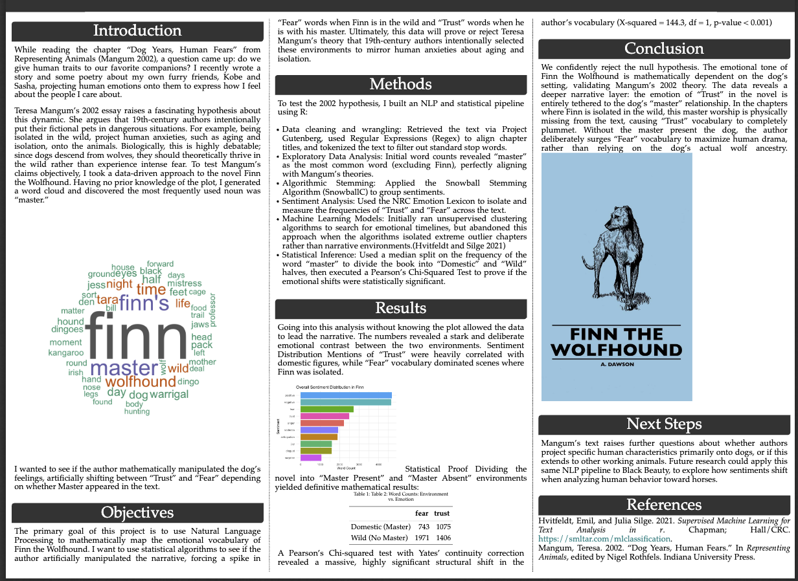

# 🐺 Finn the Wolfhound: A Data-Driven Dog Story 📊

## 📖 The Big Question
Ever wonder if 19th-century authors treated dogs like actual animals, or just furry humans with anxiety? 

In 2002, literary theorist Teresa Mangum suggested that Victorian writers loved to toss their fictional pets into the dangerous wilderness just to project human fears (like aging and isolation) onto them. But wait... dogs descend from wolves! Shouldn't they *thrive* in the wild instead of being terrified? 

I decided to put this theory to the test. This project uses **Natural Language Processing (NLP)** and **statistical math** to map the emotional rollercoaster of *Finn the Wolfhound* and find out exactly what the author was up to.

## 🔬 How I Proved It (The Methodology)
To figure out if the author was mathematically manipulating Finn's feelings, I built an end-to-end NLP pipeline using R:
* **Text Wrangling:** Ripped the text straight from Project Gutenberg, aligned chapters with some Regex magic, and chopped it up into individual words.
* **Stemming:** Used the Snowball Algorithm to group environment words together (because `dark` and `darkness` are the same vibe).
* **Vibe Check (Sentiment Analysis):** Mapped the book's emotional tone using the **NRC Emotion Lexicon**, specifically hunting for words tied to **"Trust"** and **"Fear"**.
* **The Math:** Sliced the book into two environments—"Domestic" (Master is around) and "Wild" (Master is missing). Then, I ran a Pearson’s Chi-Squared test to see if the emotional shifts were statistically significant. 

## 🏆 The Verdict: The Math Doesn't Lie
Spoiler alert: Mangum was right! We confidently rejected the null hypothesis.

The data proves the author completely ignored Finn's inner wolf to maximize human drama. The emotion of "Trust" in the novel is 100% glued to "master worship." The second Finn is isolated in the wild and the master disappears, "Trust" plummets and "Fear" absolutely skyrockets. 

## 💻 The Tech Stack
* **Language:** R 
* **Toolbox:** `dplyr`, `tidytext`, `SnowballC`, `ggplot2`, `wordcloud`, `kableExtra`
* **Output Engine:** `posterdown` and `pagedown`

## 🎨 Check Out the Poster!
Want to see the charts and the final mathematical proof? Click the image below to view the full, high-resolution academic poster!

---
*🐾 "Dogs do speak, but only to those who know how to listen." (Or in this case, those who know how to code!)*